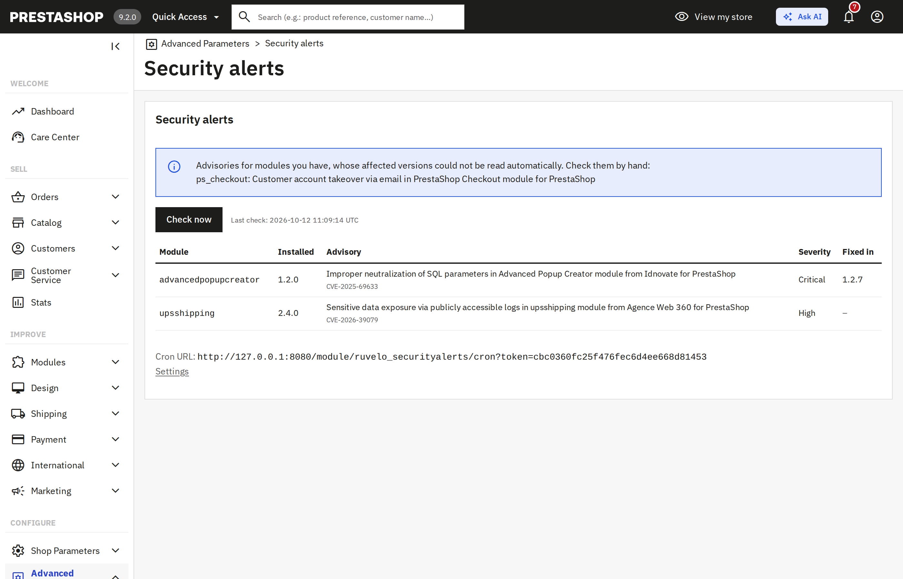
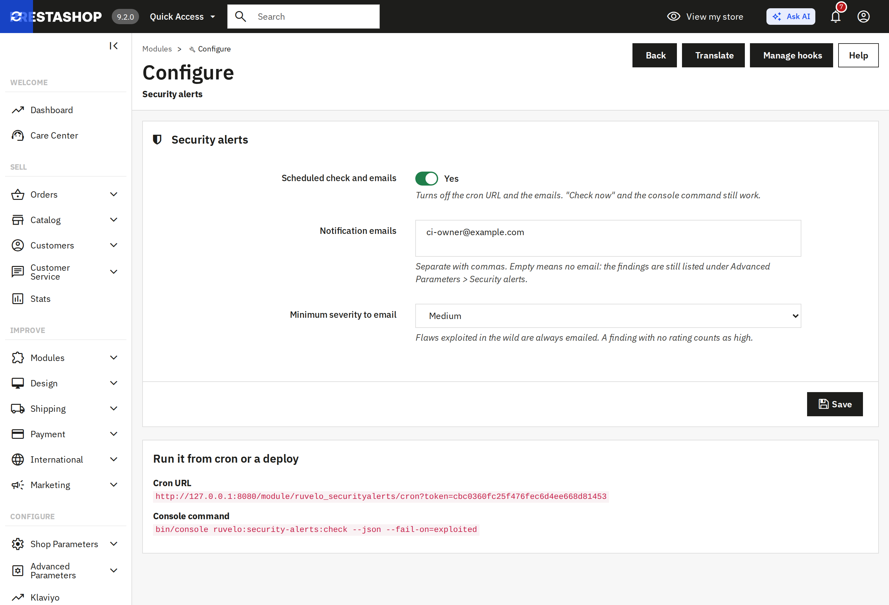

# Security Alerts for PrestaShop

**Know before they do.** This module tells you, in the PrestaShop back office and by email, when the PrestaShop you run, or a module you installed, has a known vulnerability. When the flaw is **exploited in the wild** (it is on CISA's list), it says so first: "Exploited: patch now".

PrestaShop module flaws are common and often critical (unauthenticated SQL injection, file upload, exposed logs), and the people who find them mostly publish on GitHub, not in the back office. The tools that match your modules against those advisories are mostly paid. This one is free, MIT licensed, needs no account and no API key.

Module name: `ruvelo_securityalerts`. It is the PrestaShop adapter for [`ruvelo/security-advisories`](https://github.com/Ruvelo/security-advisories), the framework-agnostic core that does the matching.

## Install

Download `ruvelo_securityalerts-<version>.zip` from the [releases](https://github.com/Ruvelo/prestashop-security-alerts/releases) (it contains the module and its `vendor/`), then either upload it under Module Manager, or:

```bash
unzip ruvelo_securityalerts-1.0.0.zip -d modules/
bin/console prestashop:module install ruvelo_securityalerts
bin/console cache:clear
bin/console ruvelo:security-alerts:check
```

The cache clear matters once: it is when PrestaShop learns about the module's console command.

Requirements: PrestaShop 8.1 or later (8.1.7, 8.2.8, 9.0.3 and 9.2.0 are each installed and tested in CI), **PHP 8.2 or later** (the core library uses PHP 8.2 features, so a shop still on PHP 7.4 to 8.1 can't run it; PrestaShop 8.1 officially lists PHP up to 8.1, so on 8.1 you are running a PHP version PrestaShop doesn't certify, which CI does exercise), the `curl` PHP extension, and outbound HTTPS to `packagist.org`, `security.friendsofpresta.org`, `raw.githubusercontent.com` and `www.cisa.gov`.

## What it checks, and what it can't

This is the part to read before you rely on it.

| What | Source | How it is matched | Reliability |
|---|---|---|---|
| PrestaShop core (`_PS_VERSION_`) | [Packagist security advisories](https://packagist.org/apidoc#list-security-advisories) for `prestashop/prestashop` (GitHub Advisory Database) | Exact version ranges | High |
| Modules PrestaShop SA ships: `ps_*` and modules whose author is "PrestaShop" | Packagist, as `prestashop/<technical name>` (for example `prestashop/ps_facetedsearch`, `prestashop/blockwishlist`) | Exact version ranges | High, but only for the ones with a published GitHub advisory |
| Third-party modules (every module, in fact) | The [Friends of Presta](https://security.friendsofpresta.org) advisories (their search index, then the text of each advisory that names one of your modules) | By module technical name, and the versions written in the advisory's "Impacted release" line | Medium, see below |
| "Is it being exploited?" | [CISA Known Exploited Vulnerabilities](https://www.cisa.gov/known-exploited-vulnerabilities-catalog) | By CVE | High, but short: few PrestaShop CVEs are on it |

**Third-party modules are the weak part, and this is why.** There is no Composer-style advisory database for third-party PrestaShop modules: Friends of Presta publish advisories as web pages (about 230 of them), not as a machine-readable feed with version ranges. The only structured part is a search index with titles and tags, and the tags usually (not always) contain the module's technical name. The affected versions are free text that people wrote: `<= 4.0.1 (4.0.2 fixed the vulnerability)`, `All versions`, `>= 1.3.0, < 4.4.1, < 5.0.5 (see details below)`. The module reads the ones it can read with certainty. Of the 222 advisories that had an "Impacted release" line when this was written, it reads 195 (186 ranges, 9 "all versions") and refuses 27, such as a lower bound followed by two upper bounds, several PrestaShop lines in prose, or versions like `7.8.a`. It never guesses: **an advisory that names a module you have but whose versions can't be read is listed on the page as "check by hand"** and is not counted as a finding.

What that means for you:

- A flaw nobody has published, or that Friends of Presta haven't covered, is not found. It is an early warning, not a scanner: it doesn't look at your files, your employees or your checkout scripts.
- A module is matched by technical name only. If two modules share a name, or an advisory's tags use a different spelling than the module folder, it is missed (or, rarely, wrongly matched).
- A module's version is read from the `module` table (what PrestaShop last installed or upgraded), and from `config.xml` for modules that are on disk but not installed. If you replaced a module's files without upgrading it in the back office, the table may be behind the files.
- **Uninstalled and disabled modules are checked too.** A module folder under `modules/` can be reached by URL whether or not it is installed, and many PrestaShop module flaws work exactly that way. The fix for a vulnerable module you don't use is to delete its folder.
- Themes and non-module code are not checked. Core advisories that are only on Friends of Presta (and not on Packagist) are not checked.
- PrestaShop's ps_checkout and a few others number versions by PrestaShop major (`8.5.0.5` on PrestaShop 8). The Packagist ranges for them are exact; a Friends of Presta line for the same module is only used when Packagist doesn't have the same CVE.
- The existing free [MyPresta Security Scan](https://mypresta.rocks/free-security-scan) module also matches installed modules against a curated list. This module differs by using the public advisories directly, adding the exploited-in-the-wild flag, emailing only what is new, and having a console command for deploy pipelines. I could not verify MyPresta's depth, so I make no claim about which finds more.

## A quick tour

> **These are real screenshots, taken by CI** ([`.github/ci/screenshots.py`](.github/ci/screenshots.py)) in a PrestaShop 9.2.0 installed for the test, with this module installed from the release zip. The two modules listed, `upsshipping` and `advancedpopupcreator`, are empty stub folders (a `config.xml` each) named after modules that have published advisories, at versions those advisories cover. No exploited finding appears because no PrestaShop module is on CISA's list today; when one is, it gets a red "Exploited: patch now" badge and goes first. The blue box is real too: Friends of Presta's `ps_checkout` advisory has an ambiguous version line, so the page asks you to check it by hand rather than guess.



**One page, exploited first.** Advanced Parameters > Security alerts lists every finding: the module, the installed version, the advisory (a link), the CVE, the severity and the first fixed version. "Check now" runs the check straight away. A dashboard widget shows the counts.



## Features

- **PrestaShop and its modules.** The exact PrestaShop version, the modules PrestaShop ships via Packagist, and every other module via Friends of Presta.
- **Exploited in the wild, first.** Findings whose CVE is on the CISA list are labelled "Exploited: patch now", sorted first, and always emailed.
- **A page under Advanced Parameters > Security alerts**, with a token-protected "Check now" button, and a **dashboard widget** (`dashboardZoneOne`) with the counts.
- **Only what is new.** Findings are stored, so you get an email for a new finding, or for one that has *become* exploited, and not the same list every morning. A failed email is retried at the next check.
- **A fix version** when the advisory gives one.
- **Cron and CLI.** A secure cron URL for shared hosting, and `bin/console ruvelo:security-alerts:check` for pipelines.
- **Admin only.** Nothing is added to the storefront, so any theme is the same to it. No JavaScript on your pages.
- **Free sources, no keys.** And a handful of HTTPS requests a day.

Watching many shops? [Valtry](https://valtry.co.uk/?utm_source=ruvelo&utm_medium=github&utm_campaign=prestashop-security-alerts) checks every site from the outside, daily.

## What leaves your server

| Request | Sent | Why |
|---|---|---|
| `POST https://packagist.org/api/security-advisories/` | the names `prestashop/prestashop` and `prestashop/<name>` for the modules PrestaShop ships. Versions are matched here. | advisories for PrestaShop and its own modules |
| `GET https://security.friendsofpresta.org/search.json` | nothing | the index of advisories |
| `GET https://raw.githubusercontent.com/friends-of-presta/security-advisories/main/_posts/<advisory>.md` | nothing but the request itself; only for advisories whose tags name a module you have | the affected versions |
| `GET https://www.cisa.gov/sites/default/files/feeds/known_exploited_vulnerabilities.json` | nothing | which CVEs are exploited |

Honest note on the third row: asking for an advisory's page tells GitHub that your server is interested in that advisory, which hints that you have that module. Your shop's address, module list, versions, customers and employees are never sent. No account, no key. Responses are cached under `var/cache` (advisories one hour, an advisory's text one week, the CISA list six hours).

It does not install, change or update anything, and writes only to its own table and to `var/cache`.

## Configuration

Modules > Security alerts > Configure.

| Setting | Default | |
|---|---|---|
| Scheduled check and emails | Yes | Turns off the cron URL and the emails. "Check now" and the console command still work |
| Notification emails | empty | Comma-separated. Empty means no email: findings are still listed on the page |
| Minimum severity to email | Medium | Exploited findings are always emailed. A finding with no rating counts as High |

### Cron

The settings page shows a secret URL; call it once a day:

```
17 3 * * * curl -fsS "https://your-shop.example/index.php?fc=module&module=ruvelo_securityalerts&controller=cron&token=..."
```

It answers `{"ok":true,"findings":2,"exploited":0,"emailed":0,"problems":0}`, or `403` for a wrong token. The token is generated at install; to change it, delete the `RUVELO_SA_CRON_TOKEN` configuration row and open the settings page.

## Command line

```
bin/console ruvelo:security-alerts:check [--json] [--fail-on=exploited|critical|high|medium|any] [--dry-run] [--fresh]
```

| Option | What it does |
|---|---|
| *(none)* | Check, store what changed, email what is new, print the findings |
| `--json` | Print the report as JSON |
| `--fail-on=…` | Exit with code `1` if a finding is at least that bad (`exploited` means only the exploited ones) |
| `--dry-run` | Only report: nothing stored, no email |
| `--fresh` | Skip the response cache |

Exit codes: `0` fine, `1` a finding met `--fail-on`, `2` a source could not be read in full (a "no findings" that isn't "clean") or an option is wrong. For a deploy pipeline:

```bash
bin/console ruvelo:security-alerts:check --dry-run --json --fail-on=exploited > alerts.json
```

## Development

`composer check` runs the PrestaShop coding standard, PHPStan level 6 (against small PrestaShop stubs, so no shop is needed) and the unit tests, exactly as CI does. The unit tests never touch the network: a mock PSR-18 client serves real recorded Friends of Presta pages. CI also installs real PrestaShops and the release zip. See [CONTRIBUTING.md](CONTRIBUTING.md) and the [changelog](CHANGELOG.md).

`bin/build-zip.sh` builds the installable zip, with its own `vendor/`. Until `ruvelo/security-advisories` is on Packagist, `composer.json` points at its GitHub repository.

## Credits

Built by [François Bultez](https://github.com/francoisbultez) at [Valtry](https://valtry.co.uk/?utm_source=ruvelo&utm_medium=github&utm_campaign=prestashop-security-alerts), the website security scanner, and everyone who [contributes](https://github.com/Ruvelo/prestashop-security-alerts/graphs/contributors).

Advisories come from the [Friends of Presta security team](https://security.friendsofpresta.org) (their advisories are CC BY-SA 4.0), [Packagist](https://packagist.org) and, through it, the [GitHub Advisory Database](https://github.com/advisories), and [CISA](https://www.cisa.gov/known-exploited-vulnerabilities-catalog). Thanks to everyone who maintains them.

## License

MIT. See [LICENSE](LICENSE). PrestaShop's own modules are AFL-3.0. I looked for a rule that makes MIT unacceptable for a module distributed from GitHub and found none, but I did not find or verify the Addons marketplace's licence requirements for submissions; if they ask for AFL-3.0 or OSL-3.0, that would be a separate release.
